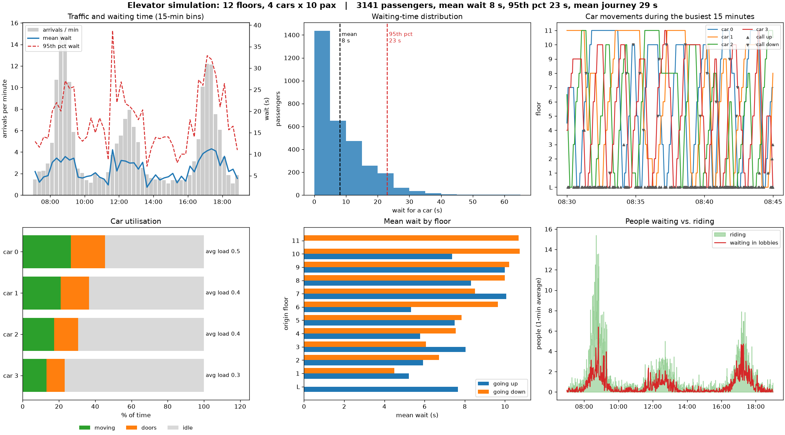
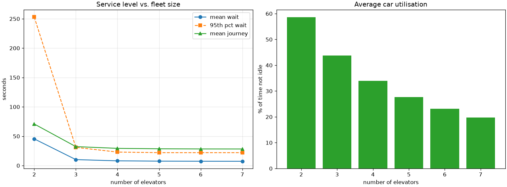
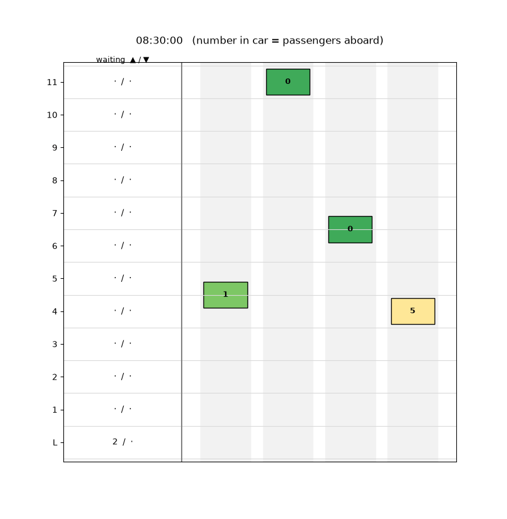

# Elevator Simulation

A discrete-time (1 s per tick) simulation of a bank of elevators serving an office
building over a working day, analysed with **pandas** and plotted with **matplotlib**.



## What it models

- **Time-varying traffic** — morning up-peak, lunch, evening down-peak, plus
  background inter-floor trips (Poisson arrivals).
- **Collective-control cars** — keep travelling while there are requests ahead,
  then reverse; capacity limit; door and boarding times.
- **Group dispatcher** — a cost function assigns every hall call to the car
  expected to reach it soonest.

Every passenger and every car position is logged into pandas DataFrames,
summarised, exported to CSV and plotted.

## Quick start

```bash
pip install -r requirements.txt
python elevator_sim.py                      # 12 floors, 4 cars, 07:00-19:00
python elevator_sim.py --elevators 3 --floors 20
python elevator_sim.py --compare            # sweep 2..7 cars
python elevator_sim.py --animate            # watch the busiest 15 minutes
python elevator_sim.py --save-anim output/peak.gif --no-show
python elevator_sim.py --help               # all options
```

## Sample results (12 floors, 4 cars × 10 passengers, 07:00–19:00)

| Metric | Value |
|---|---|
| Passengers | 3,141 (100% delivered) |
| Mean wait | 8.0 s |
| 95th percentile wait | 23 s |
| Mean journey | 29.3 s |
| Car busy | 34% |

### Fleet-size comparison

| Cars | Mean wait (s) | 95th pct wait (s) | Mean journey (s) |
|---:|---:|---:|---:|
| 2 | 45.5 | 253 | 70.8 |
| 3 | 10.1 | 31 | 32.3 |
| 4 | 8.0 | 23 | 29.3 |
| 5 | 7.6 | 22 | 28.6 |
| 6 | 7.4 | 22 | 28.3 |
| 7 | 7.3 | 22 | 28.2 |

Going from 2 to 3 cars is a big improvement; past 4 cars the gains are small.





## Output files (`output/`)

| File | Contents |
|---|---|
| `summary.csv` | Headline metrics |
| `passengers.csv` | One row per passenger: arrival, boarding, alighting, wait, ride |
| `car_trace.csv` | Every car's position, load and state each second |
| `by_15min.csv` | Arrivals and waits in 15-minute bins |
| `comparison.csv` / `.png` | Fleet-size sweep (`--compare`) |
| `dashboard.png` | Six-panel summary dashboard |
| `peak.gif` | Animation of the busiest 15 minutes |
